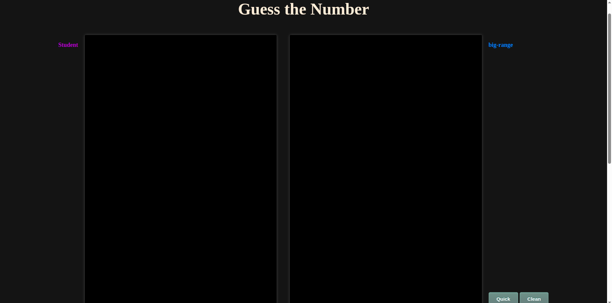
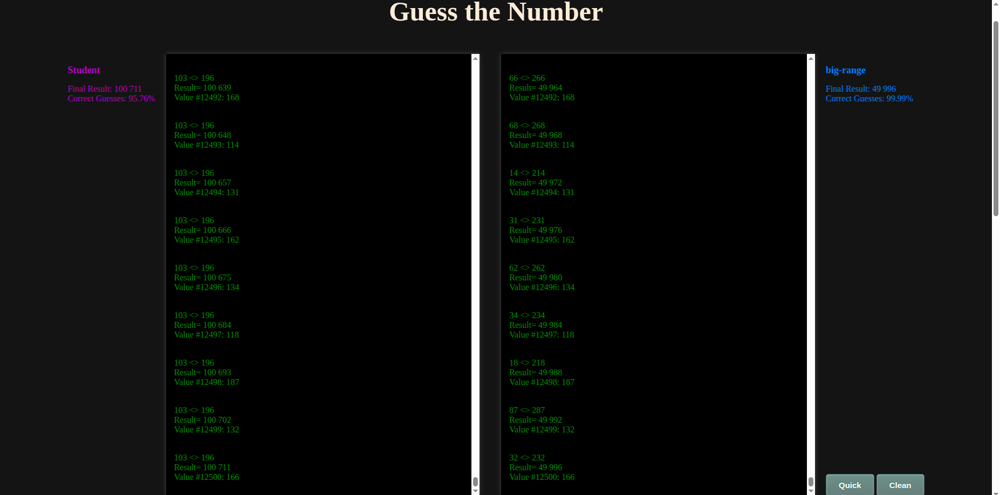

# Guess It

A Go program that reads numbers from standard input, one per line, and after each number prints a **range** in which the next number is expected to be.

It reuses the statistics from the `math-skills` project (median, deviation), but works incrementally: the range is updated after every new number.

## Features

- Reads numbers from standard input until the end of input
- After each number, prints `min max` for the next expected value
- Keeps the numbers in a sorted slice (binary insertion), so there is no full re-sort at each step
- Uses robust statistics (median and MAD) instead of average and standard deviation, so extreme values affect the range less
- Invalid lines are ignored

## Requirements

- Go 1.19 or later
- Docker (only to run the tester)

## Usage

There are two ways to use this project: run the program alone, or run it inside the tester (website).

### Run the program alone

From the `student` folder:

```bash
cd guess-it-dockerized/student
go run .
```

The program then waits for input: **you have to type the numbers manually**, one per line, and press Enter after each one. After each number, it prints the range predicted for the next one. Stop it with `Ctrl+D` (end of input) or `Ctrl+C`.

Example:

```
$ go run .
189
151.2 226.8
113
...
```

You can also give it a whole list of numbers at once, which is faster than typing them:

```bash
printf "189\n113\n121\n114\n145\n" | go run .
```

or from a file (one number per line):

```bash
cat numbers.txt | go run .
```

This mode does **not** open any website. It is only meant to try the program quickly.

### Run it with the tester (website)

The tester sends the numbers to the program automatically, so there is nothing to type. See the [Testing with the tester](#testing-with-the-tester) section below.

### Entry point for the tester

The `script.sh` file is what the tester runs. It must be executable:

```bash
chmod +x guess-it-dockerized/student/script.sh
```
## Input / Output

The input is one number per line. After each number, the program prints the range for the next one.

Example (illustrative values):

```
$ go run .
189
151.2 226.8
113
...
```

The first line is the number you typed, and the second is the range predicted for the next number.

## How it works

1. Each new number is inserted into a sorted slice
2. The **median** of all numbers seen so far is computed
3. The **MAD** (median absolute deviation) is computed, multiplied by `1.4826` so that it is comparable to a standard deviation
4. The range is computed as follows:

| Situation            | Range                              |
|----------------------|------------------------------------|
| Fewer than 5 numbers | `median × 0.8` to `median × 1.2`   |
| 5 numbers or more    | `median ± 1.25 × (1.4826 × MAD)`   |

A smaller range gives a higher score when the guess is right, but more misses. The factor `1.25` is the balance chosen between the two.

## Testing with the tester

The project is checked with the tester provided by Zone01 (`guess-it-dockerized`). My `student/` folder is already inside it.

### 1. Build the program

The tester may run inside a Docker container where Go is not installed, so `go run .` could fail silently. To avoid this, compile the program first:

```bash
cd guess-it-dockerized/student
go build -o solution .
```

This creates an executable named `solution` in the `student/` folder.

### 2. Check `script.sh`

`script.sh` is the file the tester runs, from the root of the tester folder. It must start the compiled program:

```bash
#!/bin/sh
./student/solution
```

Make it executable:

```bash
chmod +x guess-it-dockerized/student/script.sh
```

### 3. Start the tester

It needs Docker. Keep this terminal open while you test:

```bash
cd guess-it-dockerized
docker compose up
```

### 4. Open the website

Go to [http://localhost:3000/?guesser=big-range](http://localhost:3000/?guesser=big-range).

The `guesser` parameter is required: it is the name of one of the files in the `ai/` folder (for example `big-range`). It is the reference program that `student` is compared with.

### 5. Run a test

Click a **Test Data** button to choose a data set.



- **Quick** skips the waiting and shows the final results directly
- **Clean** clears the displays. The tester uses big data sets, so it is advised to click it after each test

The page shows my program (`Student`) next to the reference guesser (`big-range`), with the final result and the percentage of correct guesses.



### Troubleshooting

- **The page stays empty or shows no results**: check that `solution` exists and that `script.sh` is executable
- **Error in the terminal or the browser console (F12)**: read the message, it usually names the missing file or the wrong path
- **The page does not load**: make sure `docker compose up` is still running and that port 3000 is free
- **After changing the code**: rebuild with `go build -o solution .` and restart the tester

## Project structure

```
.
├── README.md
├── images
│   ├── tester-home.png
│   └── tester-results.png
└── guess-it-dockerized
    ├── ai/                  (reference guessers)
    ├── data_sets/           (test data, 1 to 9)
    ├── docker-compose.yml
    ├── index.html
    ├── server.js
    └── student              (my solution)
        ├── go.mod
        ├── main.go
        ├── tools
        │   ├── listenb.go
        │   └──mathtools.go
        └── script.sh
```

Only the `student/` folder and this README are my work. The rest comes from the Zone01 tester.

## Author

swannsavary